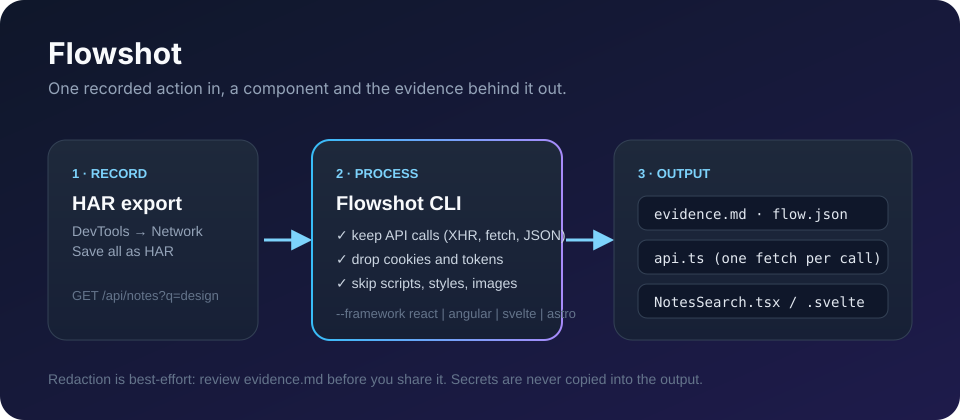
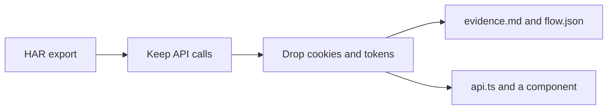

**English** · [العربية](docs/README.ar.md)

# Flowshot

Record one action in the browser. Get a component, and the evidence for every request it makes.

```bash
npm install
npm run build
node dist/cli.js build examples/notes-search.har --out examples/notes-search --name NotesSearch
```

That sample capture contains a session cookie and a bearer token. Neither is copied into the output. The static `app.js` request is ignored. What remains is `GET /api/notes?q=design`, a typed client, and a search form that renders `items`.




## What you get

| File | Role |
| --- | --- |
| `evidence.md` | The calls that were kept, with status, timing, and response shapes |
| `flow.json` | The same findings for an agent |
| `api.ts` | A fetch function per call |
| `NotesSearch.tsx`, `notes-search.component.ts`, `NotesSearch.svelte`, or `NotesSearch.astro` | A form and a result list |

The component only calls endpoints that were in the HAR. If a field is missing from one of the recorded rows, the generated type marks it optional. In the sample, `updatedAt` is optional because the second note did not have it.

## Capture a flow

1. Open Chrome DevTools → Network.
2. Do the one action you want to rebuild.
3. Right-click the request list → **Save all as HAR with content**.
4. Run Flowshot on that file.

```bash
node dist/cli.js build ./my-flow.har --out ./generated --name ProjectSearch --framework angular
```

`--framework` is `react` (the default), `angular`, `svelte`, or `astro`.

## Use it from an agent

`flowshot mcp` speaks the Model Context Protocol on stdin. One tool: `build_flow_from_har`.

```json
{
  "mcpServers": {
    "flowshot": {
      "command": "node",
      "args": ["dist/cli.js", "mcp"]
    }
  }
}
```

Point `args` at your checkout until the package is published. The matching instructions for an agent live in `skills/flowshot/SKILL.md`.

## How a capture becomes a component



A request is kept when it is XHR or fetch, returns JSON, or hits a path containing `/api/`. Scripts, styles, and images are counted as ignored. `OPTIONS` and `HEAD` are ignored too.

## Roadmap

1. **Now.** HAR in, evidence and a React, Angular, Svelte, or Astro component out.
2. **Next.** Playwright traces and the Chrome recorder JSON, on the same evidence format.
3. **Then.** A screenshot you supply, aligned to the same timeline, so an agent can match the layout to the calls.
4. **Setup.** `npx flowshot setup` registers the MCP server with Cursor and the other local agents.

Screen recording is not in this version. The honest input is a HAR you export yourself.

## Limits

Flowshot rebuilds the data flow, not the pixels. It does not replay the original session. Add authentication in the project that hosts the generated component.

Use it on a flow you recorded and are allowed to examine.

## Development

Node.js 22 or newer.

```bash
npm test
```

Report security issues through [SECURITY.md](SECURITY.md). MIT license.
